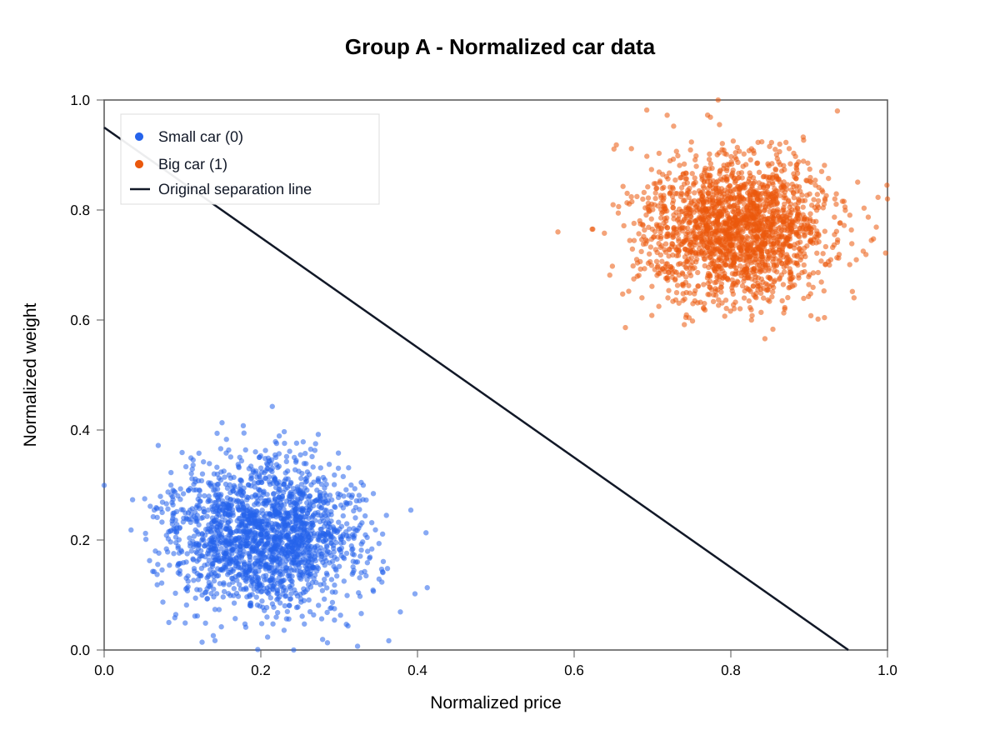

# Car Classification and a McCulloch–Pitts Neuron

**CMSC 436 – Artificial Intelligence | Virginia Commonwealth University**
**Author: Kannan Venkateswaran | Primary implementation: C++17**

This project reconstructs an academic AI assignment in C++17. It loads and
validates vehicle datasets, normalizes price and weight, draws SVG scatter
plots, evaluates a fixed weighted linear threshold classifier, and verifies a
three-input McCulloch–Pitts neuron against a Boolean truth table.

The classifier uses predetermined weights and thresholds; it does not train
parameters or measure generalization on a held-out test set. The engineering
focus is reproducible calculations, reusable libraries, clear interfaces, and
automated tests.

## Requirements

- A C++17 compiler with `std::filesystem` support.
- CMake 3.16 or newer, plus a build tool such as Make or Ninja.
- Python 3 for the automated regression tests (standard library only).

R and third-party C++ libraries are not required. Commands below target macOS
and Linux using a single-configuration CMake generator such as Make or Ninja.
Run them from `01-car-classification/`, the directory containing this README,
`CMakeLists.txt`, and `data/`.

## Build, test, and run

```bash
cmake -S . -B build -DCMAKE_BUILD_TYPE=Release
cmake --build build --parallel
ctest --test-dir build --output-on-failure

./build/data_analysis
./build/linear_classifier
./build/mcculloch_pitts
```

The applications read `data/` relative to the current working directory and
create `results/` automatically. Remain in the project root when running them.
CTest writes its smoke-test results inside `build/`; the explicit application
commands above produce the root-level outputs intended for inspection.

To build only the applications, without requiring Python:

```bash
cmake -S . -B build-apps -DCMAKE_BUILD_TYPE=Release -DBUILD_TESTING=OFF
cmake --build build-apps --parallel
```

## Architecture

| Files or directory | Responsibility |
|---|---|
| `include/car_data.hpp`, `src/car_data.cpp` | Shared records, numeric parsing, loading, min-max normalization |
| `include/data_analysis.hpp`, `src/data_analysis.cpp` | SVG plotting through `data_analysis_lib` |
| `include/linear_classifier.hpp`, `src/linear_classifier.cpp` | Predictions, confusion matrices, metrics through `linear_classifier_lib` |
| `include/mcculloch_pitts.hpp`, `src/mcculloch_pitts.cpp` | Neuron logic, truth table, threshold range, reporting through `mcculloch_pitts_lib` |
| `src/*_main.cpp` | Three application entry points and error handling |
| `tests/test_*.cpp` | Native tests linked against the public library interfaces |
| `tests/regression_tests.py` | End-to-end regression and invalid-input checks |
| `data/` | Original, unmodified vehicle datasets |
| `results/` | Seven reproducible C++ sample outputs |
| `reference/r/` | Archived R scripts; excluded from the build and run workflow |
| `docs/VERIFICATION.md` | Verification evidence and memory-safety methodology |

Both the analysis and classifier libraries link to `car_data`. The neuron
library is independent. Applications and tests link the compiled libraries;
tests do not include `.cpp` implementations or require special `main()` macros.

## Data and calculations

Each of `groupA.txt`, `groupB.txt`, and `groupC.txt` contains 4,000 records:
2,000 small cars and 2,000 large cars. The headerless CSV fields are price in
USD, weight in pounds, and class (`0` = small, `1` = large).

Price and weight are independently min-max normalized within each group:

```text
normalized_value = (value - minimum) / (maximum - minimum)
```

The loader rejects missing or empty inputs, malformed numbers, non-finite
values, invalid labels, and constant-valued features that cannot be normalized.

With normalized price `x` and weight `y`, the classifier predicts class 1 when
`2*x + y >= T`, and class 0 otherwise. Thresholds are 0.95 for A, 1.02 for B,
and 0.98 for C.

**The original report used different equations for plotting and classification.**
The SVGs preserve the visualization line `x + y = T`; they do not show the
classifier's `2*x + y = T` decision boundary. Both formulas are retained for
reproducibility.

| Dataset | Accuracy | Precision | Recall | F1 |
|---|---:|---:|---:|---:|
| A | 99.80% | 99.60% | 100.00% | 99.80% |
| B | 67.90% | 60.90% | 100.00% | 75.70% |
| C | 55.30% | 52.83% | 98.95% | 68.88% |

The CSV also reports error rate, specificity, false-positive rate, and
false-negative rate. Metrics are percentages; undefined ratios return NaN.



The McCulloch–Pitts neuron uses weights `(-3, 3, 1)` and threshold `-1`:
`output = 1` when `-3*X + 3*Y + Z >= -1`. All eight binary input combinations
match `(NOT X) OR Y`. The valid threshold interval is `-2 < T <= 0`;
with integer thresholds, `-1` and `0` both work.

## Generated outputs

| Application | Output under `results/` |
|---|---|
| `data_analysis` | `figures/groupA_normalized.svg`, `figures/groupB_normalized.svg`, `figures/groupC_normalized.svg` |
| `linear_classifier` | `classification_metrics.csv`, `confusion_matrices.csv` |
| `mcculloch_pitts` | `mcculloch_pitts_truth_table.csv`, `mcculloch_pitts_threshold_range.csv` |

These CSVs and SVGs are intentionally retained as GitHub samples. They can be
deleted and regenerated. The older R-generated PNGs are omitted.

## Automated testing and sanitizers

CTest registers 14 tests: three smoke tests, three output regression tests,
five invalid-input tests, and three native C++ unit-test executables. Native
tests use explicit checks that remain active in Release builds. Run the Python
harness without `-O` or `PYTHONOPTIMIZE`; it fails explicitly if assertions are
disabled.

For GCC or Clang with AddressSanitizer and UndefinedBehaviorSanitizer:

```bash
cmake -S . -B build-sanitize -DCMAKE_BUILD_TYPE=Debug \
  "-DCMAKE_CXX_FLAGS=-fsanitize=address,undefined -fno-omit-frame-pointer" \
  "-DCMAKE_EXE_LINKER_FLAGS=-fsanitize=address,undefined"
cmake --build build-sanitize --parallel
ASAN_OPTIONS="halt_on_error=1" \
UBSAN_OPTIONS="halt_on_error=1:print_stacktrace=1" \
ctest --test-dir build-sanitize --output-on-failure
```

Sanitizers detect problems on exercised execution paths; passing tests do not
prove that all possible inputs are safe. See `docs/VERIFICATION.md` for the
checks performed on this revision and the distinction from memory profiling.

## Clean and reproduce a first run

From the project root, the following removes the named generated build folders,
all root-level results (including old PNGs), and possible direct-test leftovers.
It leaves source files, original datasets, R references, and Git history intact.
If the sample outputs are tracked, Git will show their deletion until rerun.

```bash
# Check the directory before deleting generated files.
pwd
ls CMakeLists.txt data/groupA.txt src/data_analysis_main.cpp

# Only remove outputs when the project-root markers exist.
if [ -f CMakeLists.txt ] && [ -f data/groupA.txt ] && [ -f src/data_analysis_main.cpp ]; then
  rm -rf -- build build-apps build-profile build-sanitize build-sanitize-refactor results
  rm -rf -- unit_results tests/__pycache__
  rm -f -- test_data.csv
else
  echo "Stop: change into 01-car-classification first."
fi

cmake -S . -B build -DCMAKE_BUILD_TYPE=Release
cmake --build build --parallel
ctest --test-dir build --output-on-failure
./build/data_analysis
./build/linear_classifier
./build/mcculloch_pitts
```

On macOS, inspect the generated plots with `open results/figures`. Build folders
are ignored by Git; the seven CSV/SVG sample outputs are intentionally tracked.
Adding `.gitignore` rules does not untrack files previously committed to Git.

## Project history

The original CMSC 436 assignment was reconstructed in R from the original data,
documentation, mathematical models, and reported results, then ported to C++17.
The C++ version consolidates data handling and separates public interfaces,
algorithm implementations, and application entry points. R scripts remain in
`reference/r/` for historical comparison only; they are not part of the
supported execution or testing workflow.