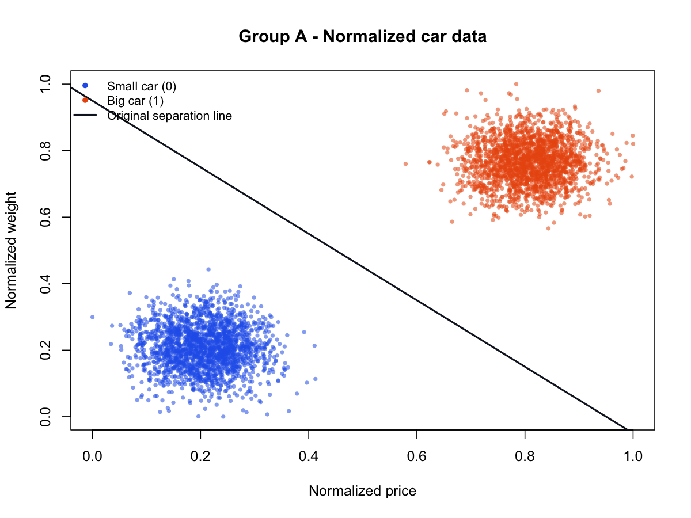

# Car Classification Using Artificial Neural Networks

**CMSC 436 – Artificial Intelligence | Virginia Commonwealth University**

## Overview

This project explores fundamental artificial intelligence concepts through
vehicle classification and the implementation of a McCulloch–Pitts artificial
neuron.

Using R, the project examines three datasets containing vehicle prices,
weights, and classifications. It applies data normalization, linear
classification, and performance evaluation to distinguish between small
and large vehicles.

The project also demonstrates how a McCulloch–Pitts neuron can implement
Boolean logic using weighted inputs and a threshold activation function.

## Technologies

- R
- Base R graphics
- Linear classification
- McCulloch–Pitts neural networks

## Project Structure

```text
01-car-classification/
├── data/                     # Original vehicle datasets
├── src/
│   ├── data_analysis.R       # Data loading, normalization, visualization
│   ├── linear_classifier.R   # Classification and performance evaluation
│   └── mcculloch_pitts.R     # Artificial neuron implementation
├── results/
│   ├── figures/              # Generated scatter plots
│   ├── classification_metrics.csv
│   ├── confusion_matrices.csv
│   ├── mcculloch_pitts_truth_table.csv
│   └── mcculloch_pitts_threshold_range.csv
└── README.md
```

## Implementation

### 1. Data Analysis

Three datasets (A, B, and C), each containing 4,000 observations,
were analyzed.

Each observation includes:
- Vehicle price
- Vehicle weight
- Classification (0 = Small, 1 = Large)

Min-max normalization was applied to price and weight values.
Scatter plots were generated to visualize the distribution of both classes.



### 2. Linear Classification

A weighted linear classifier was implemented to predict vehicle classes
using normalized price and weight.

The classifier evaluates:

2x + y >= T

Where:
- x = Normalized price
- y = Normalized weight
- T = Classification threshold

Performance was evaluated using confusion matrices, accuracy, precision,
recall, specificity, and F1-score.

#### Results

| Dataset | Accuracy | Precision | Recall | F1-Score |
|---------|----------|-----------|--------|----------|
| Group A | 99.80% | 99.60% | 100.00% | 99.80% |
| Group B | 67.90% | 60.90% | 100.00% | 75.70% |
| Group C | 55.30% | 52.83% | 98.95% | 68.88% |

Classification performance decreased as the distributions of small and
large vehicles increasingly overlapped.

### 3. McCulloch–Pitts Neuron

A McCulloch–Pitts artificial neuron was implemented using three binary
inputs (X, Y, Z).

The neuron uses:
- Weights: (-3, +3, +1)
- Threshold: -1
- Binary step activation function

The resulting Boolean expression is:

NOT X OR Y

All eight possible input combinations were evaluated and verified against
the expected truth table.

The implementation also determines the valid threshold range:

-2 < T <= 0

## Running the Project

Requires an installation of R.

From the project's root directory, run:

```bash
Rscript src/data_analysis.R
Rscript src/linear_classifier.R
Rscript src/mcculloch_pitts.R
```

Generated plots and CSV files are saved in the `results/` directory.

No additional R packages are required.

## Notes

This project was originally completed as an assignment
for CMSC 436 at Virginia Commonwealth University.

The R implementation was subsequently reconstructed using the original
datasets, project documentation, mathematical models, and experimental
results.

The reconstructed classification results match the original reported
confusion matrices.

The original report uses different linear equations for visualization
(x + y = T) and classification (2x + y >= T). Both have been preserved
to reflect the documented work.